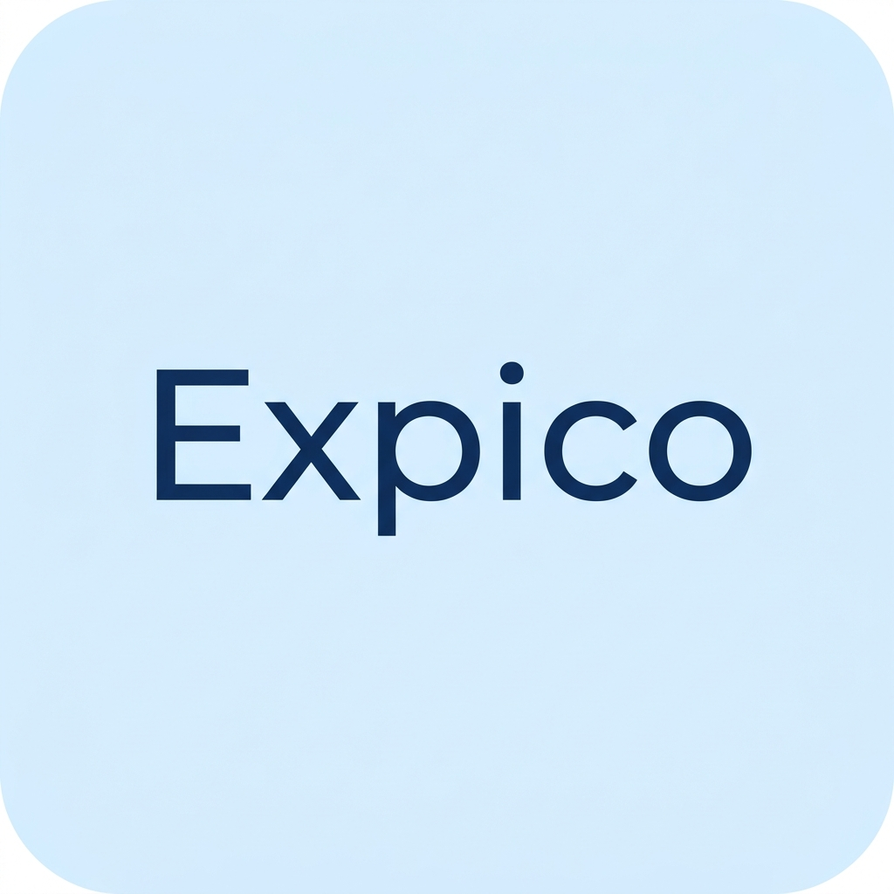

# Expico 

<p align="center">
  
</p>

<p align="center">
  <strong>A modern, offline-first personal finance and expense tracker built with Expo & React Native.</strong>
</p>

<p align="center">
  
  
  
  
  
</p>

---

## ✨ Features

- 🔒 **100% Offline-First & Private**: Zero external telemetry. All accounts, transactions, and balances are stored locally in an on-device SQLite database (`expico.db`) using WAL mode and cascading foreign keys.
- 🎨 **Adaptive Themes**: Seamless toggle between Dark and Light mode directly from Settings, respecting system appearance with automatic status bar & navigation bar coordination.
- 📊 **Insightful Analytics & Envelopes**:
  - Dynamic spending breakdown with interactive category rings.
  - Daily spending activity visualization.
  - Safe-to-Spend daily target calculation.
  - Budget health alerts when spending approaches category limits.
- 💳 **Multi-Wallet Management**: Track multiple financial sources (Bank Accounts, Cash, Savings, Credit Cards) with real-time balance aggregation.
- 🏷️ **Dynamic Categories**: Create customized income and expense categories with 20+ phosphor icons and distinct color palettes.
- 🧾 **Local Receipt Vault**: Attach receipt photos directly to transactions, stored securely in the app's local document directory.
- 👁️ **Privacy Shield**: Conceal balances with one tap for discreet browsing in public spaces.
- 🚀 **Cross-Platform Ready**: Optimized for Android, iOS, and Web with responsive moderate scaling across device form factors.

---

## 🏗️ Tech Stack

- **Framework**: [Expo SDK 58](https://expo.dev) + [React Native 0.88.1](https://reactnative.dev)
- **Routing**: [Expo Router v58](https://docs.expo.dev/router/introduction/) (File-based navigation with Stacks, Tabs, and Modals)
- **Database**: [expo-sqlite](https://docs.expo.dev/versions/latest/sdk/sqlite/) (Native SQLite with asynchronous transaction support)
- **Icons**: [phosphor-react-native](https://github.com/duongdev/phosphor-react-native)
- **Storage**: [expo-file-system](https://docs.expo.dev/versions/latest/sdk/filesystem/) (Local receipt asset persistence)
- **Gestures & Animations**: `react-native-gesture-handler`, `react-native-reanimated`, `react-native-safe-area-context`
- **Compiler**: React 19 Compiler enabled (`experiments.reactCompiler`)

---

## 📁 Project Structure

```text
expico/
├── app/                      # Expo Router navigation routes
│   ├── _layout.tsx           # Root provider layout (SQLite, GestureHandler, Stack)
│   ├── (tabs)/               # Bottom tab navigator
│   │   ├── _layout.tsx       # Tab bar configuration & custom center action button
│   │   ├── index.tsx         # Dashboard & transaction feed
│   │   ├── analytics.tsx     # Budget envelopes, metrics & visual spending rings
│   │   ├── wallets.tsx       # Accounts & net worth tracker
│   │   └── profile.tsx       # Settings, theme switcher & data management
│   └── (modals)/             # Modal route overlays
│       ├── _layout.tsx       # Modal stack header setup
│       ├── add-transaction.tsx # Create expense/income with receipt photo
│       └── add-wallet.tsx    # Create new account/wallet
├── assets/                   # App icons, splash screens & brand images
├── components/               # Reusable UI components (CategoryIcon, etc.)
├── constants/                # Color palettes, category metadata
├── db/                       # Database layer
│   ├── schema.ts             # Table creation, migrations & indexes
│   └── queries.ts            # Typed CRUD queries and transactions
├── utils/                    # Utility helpers
│   ├── fileStorage.ts        # Local receipt image handling
│   ├── formatters.ts         # Currency (₹ INR), UUID & date formatting
│   └── styling.ts            # Responsive scaling & spacing tokens
├── app.json                  # Expo application configuration & plugins
├── eas.json                  # Expo Application Services build profiles
└── package.json              # Dependencies and scripts
```

---

## 🚀 Getting Started

### Prerequisites

- [Node.js](https://nodejs.org/) (LTS `v22.x` recommended; minimum `v20.19.0`)
- [Expo Go](https://expo.dev/client) app installed on your physical device (iOS or Android)
- `npm` or `bun`


## 🛠️ Scripts & Quality Verification

| Command | Purpose |
| :--- | :--- |
| `npm start` / `npx expo start` | Starts the Metro development server |
| `npx expo lint` | Runs ESLint and React Hooks / Compiler validation |
| `npx tsc --noEmit` | Runs TypeScript type checking |
| `npx expo-doctor` | Diagnoses dependencies and SDK configuration health |
| `npx expo export` | Tests production bundle compilation across Android, iOS, and Web |

---

## 📦 Building Standalone Binaries (EAS Build)

Expico is pre-configured with [EAS](https://docs.expo.dev/eas/index.md) to generate standalone binaries in the cloud without needing local Android Studio or Xcode installations:

### Build an Installable Android APK (Testing/Preview)

```bash
# 1. Login to your free Expo account
npx eas-cli@latest login

# 2. Trigger the cloud APK build
npx eas-cli@latest build -p android --profile preview
```
Once complete, EAS provides a direct download link and QR code to install the `.apk` on any Android device.

### Build Production Bundle (Google Play Store)

```bash
npx eas-cli@latest build -p android --profile production
```
Produces an optimized `.aab` (Android App Bundle) ready for submission to the Google Play Console.

---

## 📄 License

This project is licensed under the [MIT License](LICENSE).
